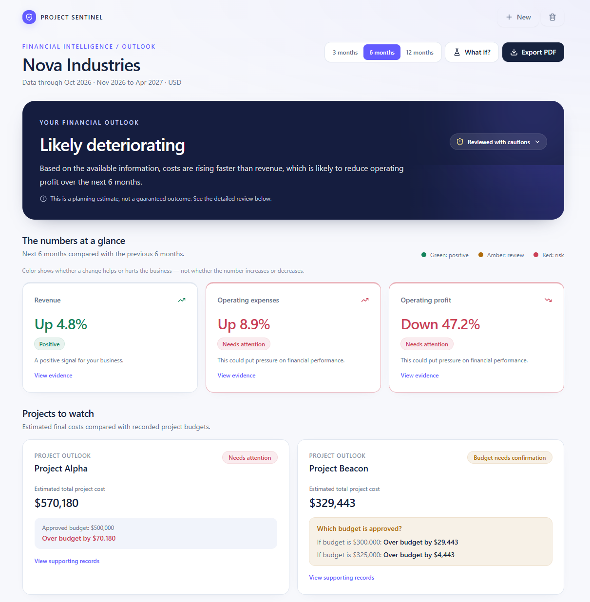

# Project Sentinel

Upload your business documents. Answer a few intelligent questions. Understand where your finances are heading and why.

Sentinel reads PDF, Word, Excel, CSV, and text files, extracts the financial facts with their sources, asks only the questions that change the forecast, runs four AI agent roles locally with Ollama Qwen3 8B (no API key), calculates forecasts in Python, and shows a one-screen outlook with the evidence behind it.


## Recommended: run with Ollama (no API key)

On Windows, install [Ollama](https://ollama.com/download/windows), extract the project, and double-click **`Start Sentinel Local AI.bat`**. The launcher checks for `qwen3:8b` and downloads it if needed. Keep ports **3000** and **8000** free by closing older Sentinel instances. Open **http://localhost:3000**.

To test **fresh, real local-model calls** for all four agents, run **`VERIFY_REAL_OLLAMA.bat`** from the project root while the local backend is running. This saves `OLLAMA_LIVE_TEST_RESULT.txt`. A passing result is required before claiming the four-agent run has been validated on your hardware. The model and other dependencies are not bundled with this source ZIP.

This local extraction revision reduces each Data Analyst response to at most two quoted observations and verifies them against their actual source. **65 focused offline checks passed** and the real Nova documents produced both project forecasts, but a fresh, successful four-agent Qwen3 run on Windows is still required; do not claim it has passed before running `VERIFY_REAL_OLLAMA.bat`. See `docs/Project_Sentinel_Writeup.docx` for the hackathon write-up.

## Keyless local AI option (experimental)

Sentinel can run all four AI roles using one locally installed **Qwen3 8B** open-weight model through Ollama. **No OpenAI/OpenRouter API key is required.** The model is NOT the same quality as GPT-6 Luna, and **live Ollama inference has not been benchmarked or confirmed on judges' hardware**. Deterministic financial calculations and source checking stay in Python.

**Windows setup:**

1. Install Ollama from https://ollama.com/download/windows and start Ollama.
2. In Command Prompt, run `ollama pull qwen3:8b` (~5 GB model download). For less RAM, try `ollama pull qwen3:4b` and set `SENTINEL_OLLAMA_MODEL=qwen3:4b` (lower accuracy).
3. In `backend/.env` set `SENTINEL_AI_PROVIDER=ollama` and `SENTINEL_OLLAMA_MODEL=qwen3:8b`. You can leave `OPENAI_API_KEY` empty.
4. Run backend and frontend normally, then use `POST http://localhost:8000/api/health/openai-test` to verify the model is returning structured responses.

Alternatively, use **Start Sentinel Local AI.bat** from the project root; it checks your dependencies, offers to download the model, and starts both servers. It does not rewrite or expose any cloud API key.

**For hackathon judges:** This local option requires running Ollama and downloading the model on *their own* machine. Merely viewing GitHub does not give a browser-based working demo. A hosted deployment or demonstration video is needed for zero-install access. This is a prototype; avoid confidential financial data.

---

## Dashboard preview



The redesigned interface presents a plain-language outlook, three key metrics, color-coded business impact, and project risks. Supporting evidence, assumptions, AI reviews, and detailed forecasts remain available on demand. Green means positive business impact, amber means review needed, and red means risk; these colors do not simply indicate whether a number increased or decreased.

## Quick start on Windows

**Recommended for this release:** Install Python 3.11–3.13, Node.js and Ollama. Run `Start Sentinel Local AI.bat` from the project root. The older manual cloud-key setup below is retained solely for developers using the optional legacy provider.

1. From the `backend` folder, run:

   ```bat
   python -m venv .venv
   .venv\Scripts\activate
   python -m pip install -r requirements.txt
   copy .env.example .env
   notepad .env
   ```

2. Add your own OpenRouter or OpenAI API key after `OPENAI_API_KEY=` in `backend/.env`, save it, then start the backend:

   ```bat
   python -m uvicorn main:app --port 8000
   ```

3. In another Command Prompt window, open the `frontend` folder and run:

   ```bat
   npm install
   npm run dev
   ```

4. Open **http://localhost:3000**. Choose the fictional Nova Industries sample to try the workflow.

If you do not add an API key, deterministic extraction and forecasting still work; AI review is disabled. Never upload `.env` or a secret API key to GitHub.

**Project status:** Hackathon prototype. Not intended for production or confidential customer data. Before hosting publicly, update and audit the frontend dependencies (including the pinned Next.js version), add authentication/authorization, and validate the financial and evidence-checking logic.

## Test status

The original project includes 84 automated backend tests. These were reported as passing in the local Windows environment with API calls disabled. An OpenRouter connection and a Nova Industries AI-reviewed PDF run were also reported from the Windows environment. This repository snapshot was separately checked for accidental inclusion of local secrets, but was not redeployed from this package.

## How it works

```
UPLOAD -> UNDERSTAND -> ASK -> ANALYZE -> PREDICT -> EXPLAIN
```

1. **Read documents.** Deterministic parsers keep the file, page, sheet, and row for every value.
2. **Data Analyst agent** reads the text and adds facts. Each fact must quote the source text and the quoted text must contain the value, or it is discarded.
3. **Reconcile.** Duplicates across files are counted once. Conflicting figures are kept side by side, never silently chosen.
4. **Clarify.** Up to five questions, essential first. The user can answer in plain words, pick an option, say "I don't know", or skip. Skips stay visible as unresolved assumptions.
5. **Forecast engine (Python, no AI).** Company metrics use candidate models compared by rolling-origin backtests. Project final cost uses explicit formulas.
6. **Emily** (company analyst) and **Sebas** (project analyst) run in parallel and interpret the numbers.
7. **Automated claim checks** test every number and citation in their findings.
8. **Alex** (independent reviewer) sees everything, can disagree, and returns trust, qualify, or withhold.
9. **Outlook.** Prediction first, three reasons, what could change it, data quality, next step. Details expand on demand.

The forecast engine runs before Emily and Sebas so they explain real calculations instead of producing numbers. Agent results are cached by a hash of their input, so after an answer only the agents whose inputs changed are called again.

## Requirements

- Python 3.11 or newer
- Node.js 18 or newer
- Optional: an OpenAI/OpenRouter API key for cloud AI, **or** local Ollama + Qwen3 for keyless AI

## Install

```bash
cd project-sentinel/backend
python -m venv .venv
source .venv/bin/activate          # Windows: .venv\Scripts\activate
pip install -r requirements.txt
cp ../.env.example .env            # then put your key in OPENAI_API_KEY

cd ../frontend
npm install
```

## Run

Two terminals.

```bash
# Terminal 1: backend on port 8000
cd project-sentinel/backend
source .venv/bin/activate
uvicorn main:app --reload --port 8000
```

```bash
# Terminal 2: frontend on port 3000
cd project-sentinel/frontend
npm run dev
```

Open http://localhost:3000. The frontend proxies `/api` to the backend, so the API key never reaches the browser. If the backend runs elsewhere, set `SENTINEL_BACKEND_URL` before starting the frontend.

## Environment variables

| Variable | Required | Default | Purpose |
|---|---|---|---|
| `OPENAI_API_KEY` | Optional cloud mode only | none | Not used in the recommended Ollama mode. |
| `OPENAI_MODEL` | No | `gpt-6-luna` | Model used by every agent. |
| `OPENAI_REASONING_EFFORT` | No | `medium` | Sent as `reasoning.effort`. Leave empty for models that do not accept it. Sentinel also drops it automatically if the API rejects it. |
| `OPENAI_TIMEOUT_SECONDS` | No | `120` | Per-request timeout. |
| `OPENAI_MAX_RETRIES` | No | `2` | Retries for timeouts, rate limits, and server errors. |
| `SENTINEL_MAX_UPLOAD_MB` | No | `25` | Per-file size limit. |
| `SENTINEL_MAX_FILES` | No | `20` | Files per investigation. |
| `SENTINEL_DATA_DIR` | No | `backend/data` | SQLite database and uploaded files. |

## Using OpenRouter

Put an OpenRouter key (starts with `sk-or-`) in `OPENAI_API_KEY`. Sentinel detects it, calls `https://openrouter.ai/api/v1`, uses Chat Completions with JSON-schema outputs, and writes the model as `openai/gpt-6-luna` automatically. Override with `OPENAI_BASE_URL`, `OPENAI_API_MODE` (`responses` or `chat`), or a full model name in `OPENAI_MODEL`.

## Test the OpenAI connection

With the backend running:

```bash
curl -X POST http://localhost:8000/api/health/openai-test
```

A working setup returns `{"ok": true, "model": "...", ...}`. Otherwise the error says what failed (missing key, authentication, unknown model, network).

## Load the sample investigation

On the home screen, click **Or load a fictional sample company (Nova Industries)**. Six documents load: two Excel workbooks, a CSV invoice ledger, a Word supplier letter, a PDF board report, and a text file of CFO notes.

To regenerate the sample files: `python sample_data/generate_samples.py` from the backend folder.

## Demonstration script

1. Load the Nova Industries sample. Six files appear with their types.
2. Click **Analyze my business**. The progress list shows each real stage.
3. Sentinel asks which Project Beacon budget is approved: $300,000 in the tracker or $325,000 in the board report. Type: *The $325k was never formally approved, use the original.* Sentinel reads the negation and uses $300,000.
4. Second question: are project costs inside operating expenses? Choose **No, tracked separately**. This switches the cash forecast to a cash bridge that subtracts remaining project spending.
5. Click **Build my outlook**. Result: **LIKELY DETERIORATING**. Costs are rising faster than revenue and both projects are forecast over budget.
6. Click **Operating profit** to see history, forecast, and range.
7. Click **View evidence** on a reason. Each record shows the file, sheet or page, row, the original text, and a link to open the file.
8. Click **What if?**, set supplier costs to +5%, and recalculate. Original, new, and difference appear, labeled hypothetical.
9. Switch the horizon to 12 months. Everything is recalculated.
10. Click **Report (PDF)**.
11. Open **Supporting evidence**: the duplicate invoices counted once, the uncertain Apex Conveyors match flagged for review, and the instruction hidden in the CFO notes reported and ignored.

The sample contains no hard-coded answers. Change a number in the generator, regenerate, and the outlook changes.

## Run the tests

```bash
cd project-sentinel/backend
python -m pytest -q
```

Agent tests use a fake OpenAI client that builds schema-valid replies from the real context, so they run without network access. They cover verified extraction, claim checks, orchestration order, caching, invalid model output, and API connection failures.

## Project structure

```
project-sentinel/
  .env.example  .gitignore  README.md
  backend/
    main.py  config.py  domain.py  requirements.txt
    api/          health.py  investigations.py
    agents/       llm_client.py  schemas.py  prompts.py  context.py
                  data_analyst.py  emily_company.py  sebas_projects.py  alex_reviewer.py
                  claim_checker.py  orchestrator.py
    documents/    pdf_parser.py  word_parser.py  excel_parser.py  text_parser.py
                  document_normalizer.py  reconciliation.py  provenance.py  security.py  pipeline.py
    finance/      calculations.py  models.py  validation.py  model_selection.py
                  company_forecast.py  project_forecast.py  drivers.py  scenarios.py  formatting.py  types.py
    services/     investigation_service.py  clarification_service.py  prediction_service.py  report_service.py
    database/     models.py  repository.py
    sample_data/  generate_samples.py  nova/ (6 generated files)
    tests/        conftest.py  fake_openai.py  test_documents.py  test_finance.py
                  test_agents.py  test_clarification_and_output.py
  frontend/
    app/          layout.tsx  page.tsx  investigation/[id]/page.tsx  globals.css  icon.svg
    components/   ui.tsx  ProgressPanel.tsx  EvidenceDrawer.tsx
    features/     InvestigationView.tsx  upload/  clarification/  outlook/  whatif/
    lib/          api.ts  format.ts
    types/        index.ts
```

## Forecasting method

- **Company series:** naive baseline, 3-month moving average, exponential smoothing, linear trend, damped trend (8+ training months), seasonal models (24+ months only). Models are compared with rolling-origin backtests; no random splits. A simpler model is kept if it is within 2% of the best. Fewer than 8 months: naive baseline, not validated, labeled limited. Fewer than 6: no numbers, only a directional signal.
- **Ranges:** approximate 80% bands from past forecast errors on the same data. They are not probabilities.
- **Profit:** derived from component forecasts using the formula the reported history confirms.
- **Cash:** statistical trend until the user says how project costs are handled; then a cash bridge from the profit forecast, calibrated on historical unexplained cash movements.
- **Projects:** estimate to complete (when supplied), earned-value (actual cost / percent complete), management forecast, recent spending rate, and committed costs as a lower bound. The strongest available method is primary; the others form the range. Known supplier price increases on open purchase orders are added. Spending is never assumed to track the schedule without reported progress.
- **Outlook colors:** green favorable, red unfavorable, amber uncertain or tentative. Costs rising no faster than revenue are neutral, not red.

## Security and privacy

- Uploaded content is wrapped as untrusted data in every prompt. Text that looks like instructions to an AI is flagged and ignored.
- Formulas are never evaluated. Excel values come from saved results; CSV cells starting with `=` are treated as text.
- File type is checked by extension and content. Macro-enabled workbooks are rejected. Size and count limits apply.
- The API key stays on the backend.
- Deleting an investigation removes its database records and uploaded files.
- This is a hackathon prototype with no regulatory or enterprise certification. Do not upload sensitive real financial data to an unapproved environment.

## Known limitations

- Live GPT-5.5 calls were not exercised in the build environment, which had no network route to the OpenAI API. Agent code paths are tested with a fake client. Run the connection test above before a demo.
- Scanned PDFs need the agents: pages without a text layer are sent to the model as PDF file input, and facts from them are marked low confidence because they cannot be checked against text.
- Legacy `.doc` needs LibreOffice installed for conversion; otherwise the user is asked to save as `.docx`.
- Deterministic table parsing covers common layouts (months down or across, project registers, ledgers, purchase orders, milestones). Unusual layouts rely on the Data Analyst agent.
- One currency per investigation; mixed currencies trigger a question rather than conversion.
- No probability of exceeding budget is shown, because no validated model for it exists on this data.
